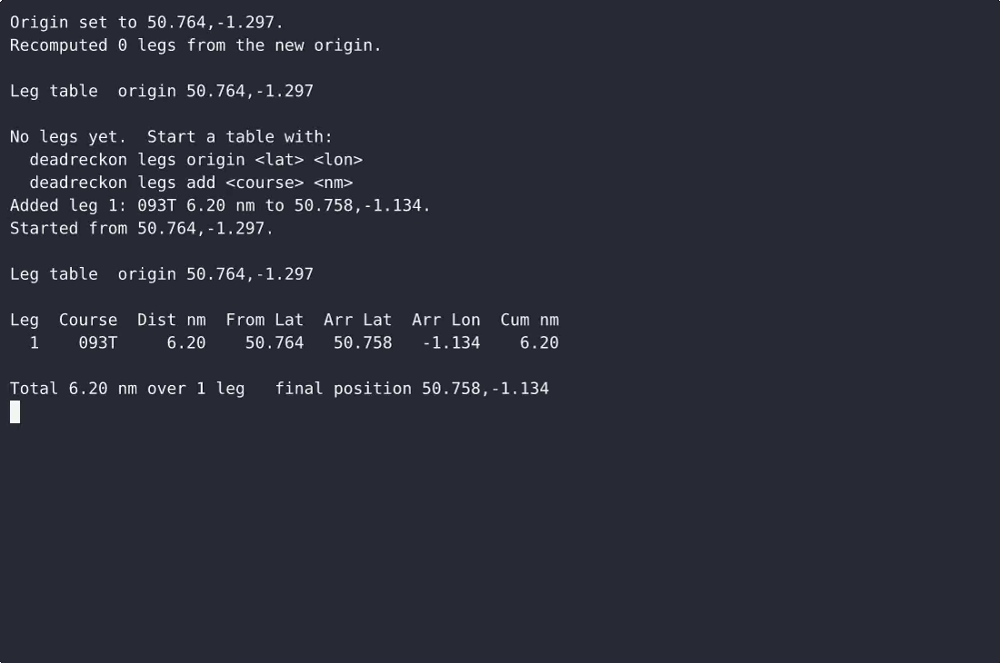
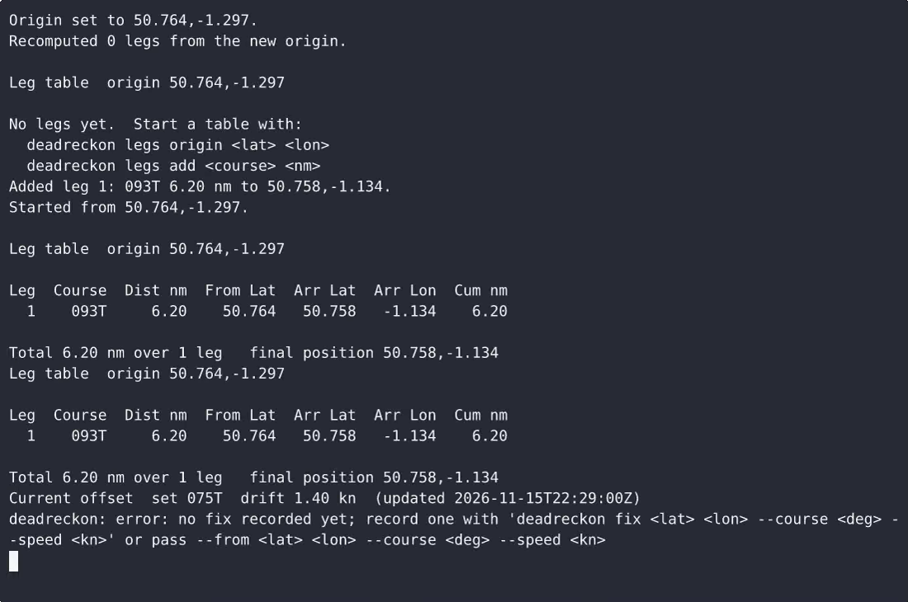

# DeadReckon — complete Full-stack app command-line tool example app

Want to run your own command-line tool without paying for SaaS? **DeadReckon** is a free, Apache-2.0-licensed Full-stack app project that you can clone and self-host today. DeadReckon is a single-file, standard-library-only Python command-line tool for dead reckoning: it keeps a course-and-distance leg table that chains great-circle legs from a set origin (nautical miles, knots, decimal…. Every DeadReckon feature — every screen, every seed record — is here. [Open DeadReckon on cenius.ai](https://cenius.ai/marketplace/p/deadreckon?ref=gh&utm_campaign=deadreckon-webapp) to modify it without writing code.


[](LICENSE)  [](https://cenius.ai)

[](https://cenius.ai/marketplace/p/deadreckon?ref=gh&utm_campaign=deadreckon-webapp)

> **▶ [Open & edit in cenius.ai](https://cenius.ai/marketplace/p/deadreckon?ref=gh&utm_campaign=deadreckon-webapp)** — one click to an editable workspace: describe changes in plain English, get an instant preview, one-click deploy and host. Modifications made on the platform come with full rebrand & relicense rights.

_Local clone? See [Quick start](#quick-start) below. cenius.ai is the zero-setup path._

## Demo


▶ **[Full demo walkthrough](https://cenius.ai/marketplace/p/deadreckon?ref=gh&utm_campaign=deadreckon-webapp)** — watch it on the project page · [download MP4](.github/media/demo.mp4)

## Screenshots

 

## Features

- Course-and-distance leg table
- Offline DR fix log
- Current drift offset entry
- Local JSON store
- Input validation and error reporting
- Machine-readable JSON output
- Clean, minimal table presentation

## Quick start

```bash
./install.sh   # installs dependencies + seeds demo data
```

See [`INSTALL.md`](INSTALL.md) for full setup and usage instructions.

## Architecture

The repository contains 24 files of Full-stack app source, organised under `examples/`, `tests/`. Dependency management and data seeding are both handled by `./install.sh` — run it once, then start the server. Full setup details: [`INSTALL.md`](INSTALL.md).

## Usage guide

Worked walkthroughs of the real commands. All examples use the default store
(`deadreckon-store.json` in the current directory); add `--store PATH` to any
command to use another file. `deadreckon` below is shorthand for
`python3 deadreckon.py` (or the console script if `install.sh` managed to
install it).

### 1. Lay out a leg table

Start from a known position — Cowes, Isle of Wight.

```sh
$ deadreckon legs origin 50.7640 -1.2970
Origin set to 50.764,-1.297.
Recomputed 0 legs from the new origin.

Leg table  origin 50.764,-1.297

No legs yet.  Start a table with:
  deadreckon legs origin <lat> <lon>
  deadreckon legs add <course> <nm>
```

Add legs as course (degrees true) and distance run (nautical miles). Each new
leg starts where the previous one arrived.

```sh
$ deadreckon legs add 093 6.2
Added leg 1: 093T 6.20 nm to 50.758,-1.134.
Started from 50.764,-1.297.

Leg  Course  Dist nm  From Lat  Arr Lat  Arr Lon  Cum nm
  1    093T     6.20    50.764   50.758   -1.134    6.20

Total 6.20 nm over 1 leg   final position 50.758,-1.134
```

```sh
$ deadreckon legs add 045 3.4
Added leg 2: 045T 3.40 nm to 50.799,-1.071.
Started from 50.758,-1.134.
```

`deadreckon legs` reprints the whole table at any time: per-leg course,
distance, both ends, cumulative distance, and the total.

#### Move the origin

```sh
$ deadreckon legs origin 51.500 -0.100
Origin set to 51.500,-0.100.
Recomputed 4 legs from the new origin.
```

Every arrival is recomputed from the new origin — the courses and distances you
entered are kept, the positions are re-derived.

#### Clear the table

_Full guide: [`USAGE.md`](USAGE.md)_

## FAQ

### How do I run DeadReckon on my own server?

It runs entirely on your own machine. Clone, run `./install.sh`, and follow [`INSTALL.md`](INSTALL.md) — the whole stack is in this repo, no external dependencies required.

### Can I build a business on DeadReckon?

It is. Apache-2.0 licensing means you can build a product on it, sell it, or use it inside a company with no fees. Details: [LICENSE](LICENSE).

### Which framework or language does DeadReckon use?

The app is built with Full-stack app. What you see in this repo is the full production source, demo data included. Highlights include current drift offset entry.

### What if I want to add features to DeadReckon without coding?

[cenius.ai](https://cenius.ai/marketplace/p/deadreckon?ref=gh&utm_campaign=deadreckon-webapp) handles the implementation. Tell it what you want in everyday words, pick up the updated build. No coding needed.

### Can I remove the DeadReckon name and use my own?

White-labeling is supported: fork the MIT-licensed source and rebrand it yourself, or use [cenius.ai](https://cenius.ai/marketplace/p/deadreckon?ref=gh&utm_campaign=deadreckon-webapp) to make changes in a guided workspace — platform modifications come with full rebrand rights.

## License & rebranding

Released under the [Apache License 2.0](LICENSE) (© 2026 Cenius AI) — free for personal and commercial use. The Cenius name/logo are trademarks (see NOTICE).

**Need a customized version?** [Remix this app on cenius.ai](https://cenius.ai/marketplace/p/deadreckon?ref=gh&utm_campaign=deadreckon-webapp) — modifications made on the platform come with **full rebrand & relicense rights** over your derivative.

## Built with cenius.ai

This entire application — code, design, seeded demo data — was generated on **[cenius.ai](https://cenius.ai)** from a plain-English description.

- 🚀 [Build your own app on cenius.ai](https://cenius.ai)
- 🎛️ [Remix DeadReckon on the marketplace](https://cenius.ai/marketplace/p/deadreckon?ref=gh&utm_campaign=deadreckon-webapp) — open it in a workspace, prompt for changes, and ship your own version.

More open-source apps: [the Cenius-ai catalog](https://github.com/Cenius-ai) · [showcase index](https://github.com/Cenius-ai/showcase)
